<div align="center">



<br>

[](https://github.com/5h4nnu-dev/CTF-Archive)
[](https://github.com/5h4nnu-dev/CTF-Archive/stargazers)
[](https://github.com/5h4nnu-dev/CTF-Archive/commits/main)

</div>


## whoami

```console
shannu@arch:~$ whoami
shannu

shannu@arch:~$ cat /etc/profile.d/mission.sh
# Build systems that find, understand and fix vulnerabilities on their own.
export ROLE="security engineer"
export FOCUS="ai + offensive security"
export HOME_BASE="india"
export DISTRO="arch"          # btw
```


## What I'm building

| Project | What it does |
| :--- | :--- |
| **Vulnix** | AI-powered vulnerability scanner |
| **SecureProbe** | Web security assessment toolkit |
| **Emotional AI** | An AI that reads personality and emotion |
| **ARIS** | AI campus surveillance system |
| **AI Team** | Autonomous multi-agent AI |
| **[CTF-Archive](https://github.com/5h4nnu-dev/CTF-Archive)** | 40-room CTF writeup blog, React + Vite |

Currently learning: malware analysis, reverse engineering, Kubernetes, cloud security, AI agents.


## Skills, as seen by nmap

<div align="center">
  
</div>

```console
languages : python  c  c++  java  bash  typescript  javascript
tooling   : linux  docker  kubernetes  git  nginx
web       : react  vite  node
```


## Featured: CTF-Archive

A dark-themed React + Vite blog that turns hands-on CTF lab work into searchable, screenshot-heavy walkthroughs. Every room follows the same shape:

`overview` > `enumeration` > `exploitation` > `privilege escalation` > `flags` > `commands used` > `lessons learned` > `references`

**Stack:** React 19, Vite 8, react-markdown 10, Oxlint 1.69. Content is plain Markdown in `src/writeups/`, loaded at build time with `import.meta.glob`.

<div align="center">
  
</div>

### What the archive covers

| Domain | Skills documented | Example rooms |
| :--- | :--- | :--- |
| Web and CMS exploitation | Webmin backdoors, CMS RCE, SQLi, file upload, command injection | AttackerKB, Source, Bolt, Ignite, Thompson, Room 404 |
| Privilege escalation | Sudo/GTFOBins, SUID, cron jobs, capabilities, PATH hijacking, containers | Wgel, Overpass, Kenobi, Kiba, Couch, Simple CTF |
| OSINT and social engineering | Gravatar hashing, SOCMINT, metadata, public clue chains | The Brochure, Overheard at Breakfast, OhSINT |
| Steganography and forensics | Image headers, binary decoding, packet captures, spectrograms | Madness, Lian_Yu, Jack, KoTH Food, CTF Collection Vol. 1 |
| Binary exploitation and CVEs | Buffer overflow, ret2win, Java deserialization, UAC bypass | The Cod Caper, Tony the Tiger, Blaster, Ice |
| Learning and custom tooling | Linux privesc lab, sqlmap tamper script, guided pentest path | Linux PrivEsc, Tamper, Path |

### App features

- **Full-text search** across titles, descriptions and tags
- **Smart filtering** by difficulty (Easy to Insane) with combinable tags
- **Reader view** with syntax-highlighted Markdown
- **In-app authoring** using YAML frontmatter and `localStorage`
- **One-click export** of any writeup as Markdown
- **Dark responsive UI** with a glassmorphism navbar and colour-coded badges

### The chain behind every post


<details>
<summary><b>Open the full 40-room index</b></summary>

<br>

| # | Room | Primary focus |
| :-- | :--- | :--- |
| 01 | [Anonforce](https://github.com/5h4nnu-dev/CTF-Archive/blob/main/src/writeups/anonforce.md) | Anonymous FTP, PGP key cracking, root hash |
| 02 | [AttackerKB](https://github.com/5h4nnu-dev/CTF-Archive/blob/main/src/writeups/attackerkb.md) | Webmin 1.890 supply-chain RCE (CVE-2019-15107) |
| 03 | [Blaster](https://github.com/5h4nnu-dev/CTF-Archive/blob/main/src/writeups/blaster.md) | RDP credentials, Windows UAC bypass |
| 04 | [Blueprint](https://github.com/5h4nnu-dev/CTF-Archive/blob/main/src/writeups/blueprint.md) | Rejetto HFS exploitation, privilege escalation |
| 05 | [Bolt](https://github.com/5h4nnu-dev/CTF-Archive/blob/main/src/writeups/bolt.md) | Bolt CMS 3.7.1 authenticated RCE |
| 06 | [Brooklyn Nine Nine](https://github.com/5h4nnu-dev/CTF-Archive/blob/main/src/writeups/brooklynninenine.md) | FTP, steganography, brute force, GTFOBins |
| 07 | [c4ptur3-th3-fl4g](https://github.com/5h4nnu-dev/CTF-Archive/blob/main/src/writeups/capturetheflag.md) | Encoding, stego, spectrogram, forensics |
| 08 | [Couch](https://github.com/5h4nnu-dev/CTF-Archive/blob/main/src/writeups/couch.md) | CouchDB exposure, Docker API, SSH tunneling |
| 09 | [CTF Collection Vol. 1](https://github.com/5h4nnu-dev/CTF-Archive/blob/main/src/writeups/ctfcollectionvol1.md) | 20 standalone mini-challenges |
| 10 | [Dav](https://github.com/5h4nnu-dev/CTF-Archive/blob/main/src/writeups/dav.md) | WebDAV webshell upload, sudo cat abuse |
| 11 | [Develpy](https://github.com/5h4nnu-dev/CTF-Archive/blob/main/src/writeups/develpy.md) | Python `input()` injection, cron abuse |
| 12 | [Easy Peasy](https://github.com/5h4nnu-dev/CTF-Archive/blob/main/src/writeups/easypeasy.md) | Web enumeration, GOST hashes, cron privesc |
| 13 | [KoTH Food CTF](https://github.com/5h4nnu-dev/CTF-Archive/blob/main/src/writeups/food.md) | Command injection, SUID screen, sudo CVE |
| 14 | [Fowsniff](https://github.com/5h4nnu-dev/CTF-Archive/blob/main/src/writeups/fowsniff.md) | OSINT, MD5 cracking, POP3, writable MOTD |
| 15 | [Ice](https://github.com/5h4nnu-dev/CTF-Archive/blob/main/src/writeups/ice.md) | Icecast CVE-2004-1561, UAC bypass, Mimikatz |
| 16 | [Ignite](https://github.com/5h4nnu-dev/CTF-Archive/blob/main/src/writeups/ignite.md) | Fuel CMS RCE (CVE-2018-16763) |
| 17 | [Jack](https://github.com/5h4nnu-dev/CTF-Archive/blob/main/src/writeups/jack.md) | Swapped ports, layered encodings, SUID strings |
| 18 | [Kenobi](https://github.com/5h4nnu-dev/CTF-Archive/blob/main/src/writeups/kenobi.md) | SMB, ProFTPD mod_copy, NFS, PATH hijack |
| 19 | [Kiba](https://github.com/5h4nnu-dev/CTF-Archive/blob/main/src/writeups/kiba.md) | Kibana prototype pollution, Linux capabilities |
| 20 | [LazyAdmin](https://github.com/5h4nnu-dev/CTF-Archive/blob/main/src/writeups/lazyadmin.md) | SweetRice backup disclosure, sudo Perl |
| 21 | [Lian_Yu](https://github.com/5h4nnu-dev/CTF-Archive/blob/main/src/writeups/lianyu.md) | Base58, PNG header repair, stego, pkexec |
| 22 | [Library](https://github.com/5h4nnu-dev/CTF-Archive/blob/main/src/writeups/library.md) | SSH brute force, sudo script replacement |
| 23 | [Linux PrivEsc](https://github.com/5h4nnu-dev/CTF-Archive/blob/main/src/writeups/linuxprivesc.md) | 10+ privesc vectors in one learning VM |
| 24 | [Madness](https://github.com/5h4nnu-dev/CTF-Archive/blob/main/src/writeups/madness.md) | Header repair, ROT13, SUID screen 4.5.0 |
| 25 | [OhSINT](https://github.com/5h4nnu-dev/CTF-Archive/blob/main/src/writeups/ohsint.md) | Pure OSINT reconnaissance |
| 26 | [Overheard at Breakfast](https://github.com/5h4nnu-dev/CTF-Archive/blob/main/src/writeups/overheardatbreakfast.md) | Discord leak, Gravatar hash, hidden flag |
| 27 | [Overpass](https://github.com/5h4nnu-dev/CTF-Archive/blob/main/src/writeups/overpass.md) | Cookie bypass, SSH key cracking, `/etc/hosts` cron |
| 28 | [Path](https://github.com/5h4nnu-dev/CTF-Archive/blob/main/src/writeups/path.md) | IDOR, upload bypass, UnrealIRCd backdoor |
| 29 | [Pickle Rick](https://github.com/5h4nnu-dev/CTF-Archive/blob/main/src/writeups/picklerick.md) | `robots.txt`, command injection, passwordless sudo |
| 30 | [Room 404](https://github.com/5h4nnu-dev/CTF-Archive/blob/main/src/writeups/room404.md) | Exposed `.git` repository reconstruction |
| 31 | [RootMe](https://github.com/5h4nnu-dev/CTF-Archive/blob/main/src/writeups/rootme.md) | File upload, Python library privesc |
| 32 | [Simple CTF](https://github.com/5h4nnu-dev/CTF-Archive/blob/main/src/writeups/simplectf.md) | CMS Made Simple SQLi, vim sudo |
| 33 | [Smag Grotto](https://github.com/5h4nnu-dev/CTF-Archive/blob/main/src/writeups/smaggrotto.md) | PCAP credentials, cron SSH-key swap |
| 34 | [Source](https://github.com/5h4nnu-dev/CTF-Archive/blob/main/src/writeups/source.md) | Webmin 1.890 backdoor, Perl injection |
| 35 | [Tamper](https://github.com/5h4nnu-dev/CTF-Archive/blob/main/src/writeups/tamper.md) | Custom sqlmap tamper for auth-gated SQLi |
| 36 | [The Brochure](https://github.com/5h4nnu-dev/CTF-Archive/blob/main/src/writeups/thebrochure.md) | Instagram SOCMINT, Base64 fragments |
| 37 | [The Cod Caper](https://github.com/5h4nnu-dev/CTF-Archive/blob/main/src/writeups/thecodcaper.md) | SQLi, GDB ret2win buffer overflow |
| 38 | [Thompson](https://github.com/5h4nnu-dev/CTF-Archive/blob/main/src/writeups/thompson.md) | Tomcat WAR deployment, world-writable cron |
| 39 | [Tony the Tiger](https://github.com/5h4nnu-dev/CTF-Archive/blob/main/src/writeups/tonythetiger.md) | JBoss Java deserialization (CVE-2015-7501) |
| 40 | [Wgel](https://github.com/5h4nnu-dev/CTF-Archive/blob/main/src/writeups/wgel.md) | Exposed SSH key, sudo `wget` privesc |

</details>


<div align="center">

*Hack to understand. Build to protect.*

Goal: become a security engineer who builds autonomous AI systems.

</div>
